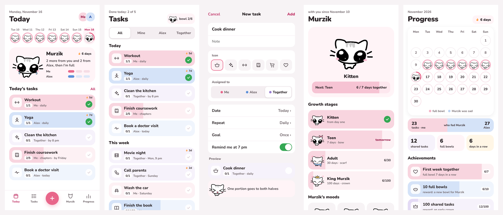

# Carranam 🐾

**Shared habit & task tracker for couples, with a virtual cat you raise together.**

Спільний трекер справ для двох. Кожна виконана справа годує вашого спільного котика Мурзіка, маскота застосунку: миска поділена навпіл, і повною вона стає, лише коли кожен зробив свою частину.



## Ідея

- **Особисті й спільні справи** в одному списку, кожен партнер має свій колір
- **Миска навпіл:** по 3 порції на кожного, а спільна справа годує обидві половинки
- **Мурзік живий:** голодує, їсть, радіє, спить і сумує залежно від вашого дня
- **Росте разом з вами:** кошеня → підліток → дорослий → король, з аксесуарами за досягнення
- **Стрік і прогрес:** календар із мордочками котика, хто скільки зробив, досягнення

## Документи

| | |
|---|---|
| 📋 [Бізнес-аналіз (BA)](docs/BA.md) | бачення, аудиторія, механіка, вимоги, user stories, бізнес-правила, модель даних, MVP |
| 🎨 [Візуал і дизайн](design/DESIGN.md) | екрани, кольори, шрифт, компоненти, Мурзік, іконки, іконка застосунку |
| 🖼 [Живий макет](https://claude.ai/artifact/1HPMj4AmYbHgtNn2qLizX4) | інтерактивне полотно з усіма екранами |

## Структура

```
docs/
  BA.md                  бізнес-аналіз продукту
design/
  DESIGN.md              візуальний гайд
  overview.png           усе на одній картинці
  tokens.json            кольори, шрифт, відступи, радіуси
  screens/               скріншоти екранів
  murzik/                котик у 6 настроях + оригінальний скетч
  murzik/stages/         етапи росту з аксесуарами
  accessories/           бантик, шарфик, корона (SVG)
  icons/                 іконки інтерфейсу й справ (SVG)
  app-icon/              іконки застосунку для PWA / iOS / Android
```

## Платформа

PWA, тобто один застосунок для iOS і Android, який встановлюється на домашній екран. Пропонований стек: React + Vite, Supabase (Auth, Postgres, Realtime), Web Push.

## Статус

🎨 Дизайн і аналіз готові · 🛠 Розробка ще не почалася

---

Малюнок котика: Тетяна ✏️
