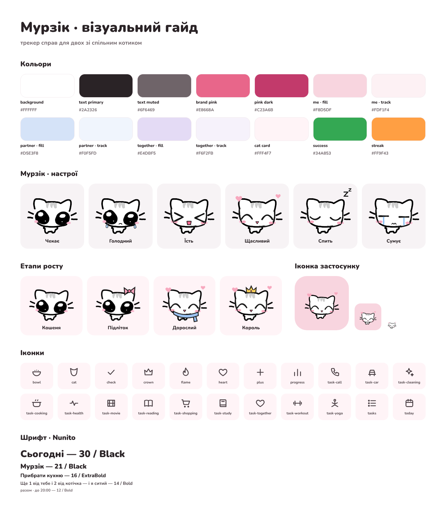
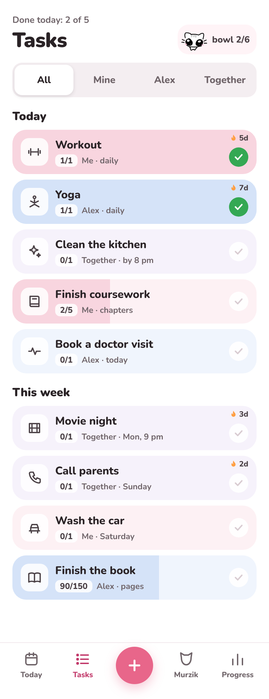
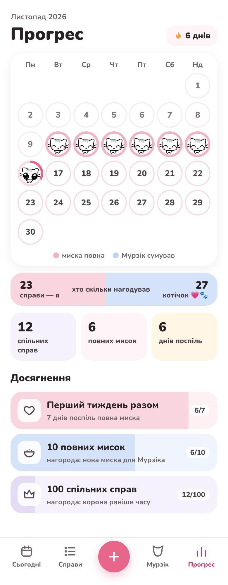

# Carranam — візуал і дизайн

Живий макет з усіма екранами (можна клікати): [відкрити полотно](https://claude.ai/artifact/1HPMj4AmYbHgtNn2qLizX4)

## Екрани

| Сьогодні | Справи | Нова справа |
|---|---|---|
|  |  |  |

| Мурзік | Прогрес | Сьогодні очима партнера |
|---|---|---|
|  |  |  |

## Стиль

Світлий і чистий, у дусі Apple Reminders: білий фон, м'які заокруглені картки без обводок, один шрифт. Мальований від руки лише котик Мурзік, тому на чистому фоні він привертає увагу.

**Головний прийом — картка як прогрес.** Фон картки справи заливається зліва направо: справу на 2 з 5 розділів залито на 40%, виконану справу повністю.

## Кольори

Колір закріплено **за людиною**, а не за словом «я», тому на обох телефонах кольори однакові.

| Токен | Колір | Де використовується |
|---|---|---|
| `owner.me.fill` / `track` | `#F8D5DF` / `#FDF1F4` | картки й половинка миски першого партнера |
| `owner.partner.fill` / `track` | `#D5E3F8` / `#F0F5FD` | картки й половинка миски другого партнера |
| `owner.together.fill` / `track` | `#E4DBF5` / `#F6F2FB` | спільні справи |
| `brand.pink` | `#E8668A` | кнопка «+», кільце сьогоднішнього дня, сегменти миски |
| `brand.pinkDark` | `#C23A6B` | посилання, активний пункт меню (контраст ≥ 4.5:1) |
| `text.primary` / `secondary` / `muted` | `#2A2326` / `#4A4045` / `#6F6469` | текст |
| `cat.cardBackground` | `#FFF4F7` | картка Мурзіка |
| `status.success` | `#34A853` | галочка виконаної справи |
| `status.streakFlame` | `#FF9F43` | вогник стріку |

Усі значення лежать у [`tokens.json`](tokens.json).

## Шрифт

**Nunito** (Google Fonts, підтримує кирилицю), насиченість 600–900.

| Роль | Розмір / насиченість |
|---|---|
| Заголовок екрана | 30 / 900 |
| Ім'я котика | 21 / 900 |
| Заголовок розділу | 17–18 / 900 |
| Назва справи | 16 / 800 |
| Текст | 14 / 700 |
| Мета, чіпи | 12 / 700–800 |
| Нижнє меню | 11 / 800 |

## Компоненти

- **Картка справи** заввишки 64 px, радіус 20. Зліва плитка-іконка 40×40, потім назва, чіп прогресу («2/5») і мета («я · щодня»). Справа стрік і кружечок-галочка (зона тапу 44 px). Заливка фону показує прогрес, анімація 450 мс.
- **Картка Мурзіка** з радіусом 26 і фоном `#FFF4F7`. У ній котик 136 px, ім'я, стрік, підказка і два рядки миски по 3 сегменти.
- **Смужка тижня** — 7 кружечків по 44 px з мордочкою котика. Сьогоднішній день показано кільцем, що заповнюється (conic-gradient).
- **Сегментований перемикач** у стилі iOS: сірий фон, вибраний сегмент білий з тінню, висота 44 px.
- **Нижнє меню**: Сьогодні · Справи · «+» · Мурзік · Прогрес. Кнопка «+» — рожеве коло 54 px.

## Мурзік

Котика намалювала Тетяна від руки, а емоції домальовані в тому ж стилі.

| Файл | Настрій | Коли |
|---|---|---|
| [`murzik-waiting.png`](murzik/murzik-waiting.png) | Чекає | 3–5 порцій з 6 |
| [`murzik-hungry.png`](murzik/murzik-hungry.png) | Голодний | 0–2 порції |
| [`murzik-eating.png`](murzik/murzik-eating.png) | Їсть | ~1,3 с після відмітки справи |
| [`murzik-happy.png`](murzik/murzik-happy.png) | Щасливий | миска повна |
| [`murzik-sleeping.png`](murzik/murzik-sleeping.png) | Спить | 23:00–07:00 |
| [`murzik-sad.png`](murzik/murzik-sad.png) | Сумує | учора миска не була повною |

Оригінальний скетч лежить у [`murzik/murzik-original-sketch.jpg`](murzik/murzik-original-sketch.jpg).

**Етапи росту** ([`murzik/stages/`](murzik/stages)): кошеня → підліток з бантиком (7 днів) → дорослий із шарфиком (30) → король у короні (100).
Аксесуари є і окремими SVG у [`accessories/`](accessories). Вони накладаються на малюнок котика в тій самій системі координат (`viewBox 0 0 676 596`).

## Іконки

Усі в [`icons/`](icons): SVG 24×24, обведення 2 px, заокруглені кінці, колір `#4A4045` (у коді можна замінити на `currentColor`).

- Навігація: `today`, `tasks`, `cat`, `progress`, `plus`
- Стан: `check`, `flame`, `bowl`, `heart`, `crown`
- Справи: `task-workout`, `task-yoga`, `task-cleaning`, `task-study`, `task-health`, `task-movie`, `task-call`, `task-car`, `task-reading`, `task-cooking`, `task-shopping`, `task-together`

## Іконка застосунку

У [`app-icon/`](app-icon) щасливий Мурзік на рожевому фоні `#F8D5DF`:
- `icon-1024.png`: App Store / джерело
- `icon-512.png`, `icon-192.png`: маніфест PWA
- `maskable-512.png`: maskable-іконка для Android (з більшим відступом)
- `apple-touch-icon-180.png`: iOS, коли застосунок додано на домашній екран
- `favicon-32.png`: вкладка браузера

## Доступність

- Контраст тексту ≥ 4.5:1: приглушений `#6F6469` на білому дає 5.7:1, `#C23A6B` дає 5.1:1
- ⚠️ На повністю залитій рожевій картці `#6F6469` дає лише 4.2:1, тому в коді мету на залитих картках краще писати `#4A4045` (7:1+)
- Зони тапу ≥ 44 px
- Власник справи позначається і кольором, і текстом («я», ім'я партнера, «разом»), тому колір не єдиний носій інформації
- Анімації котика вимикаються, якщо в системі ввімкнено «зменшити рух»
