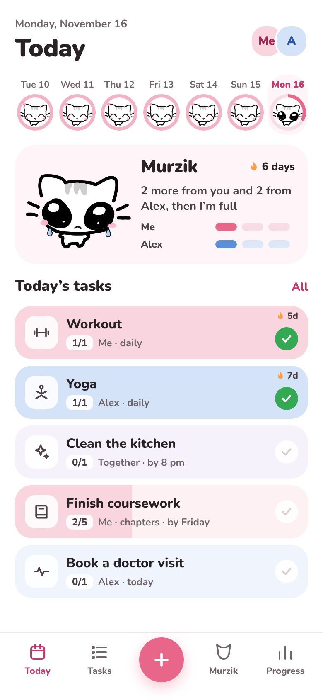
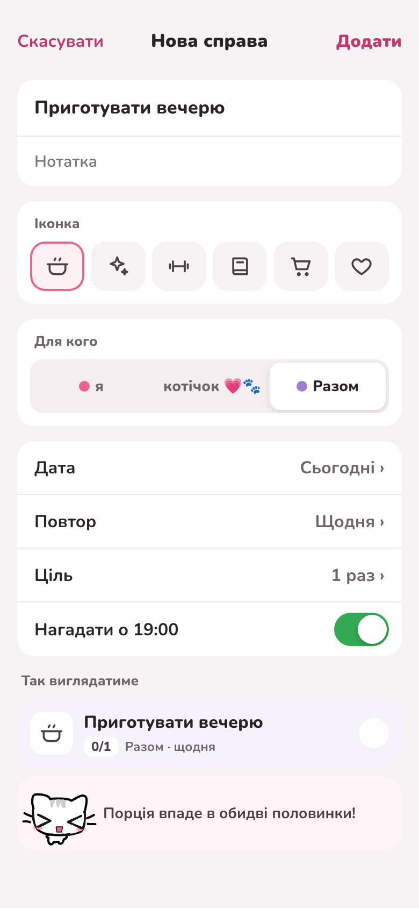
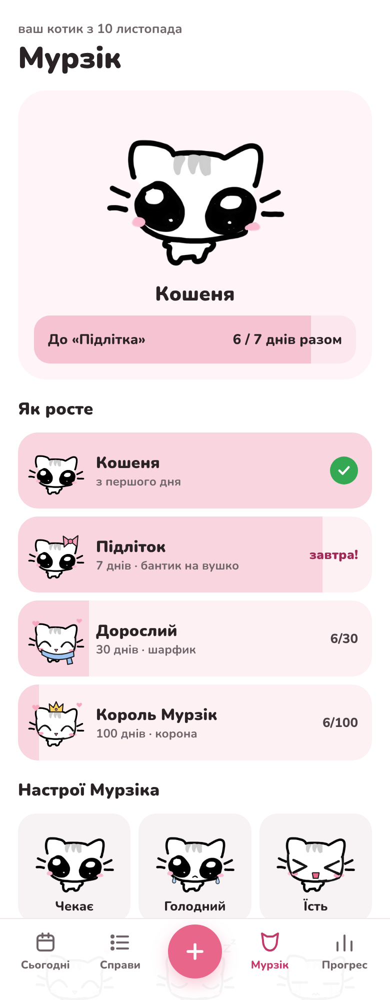
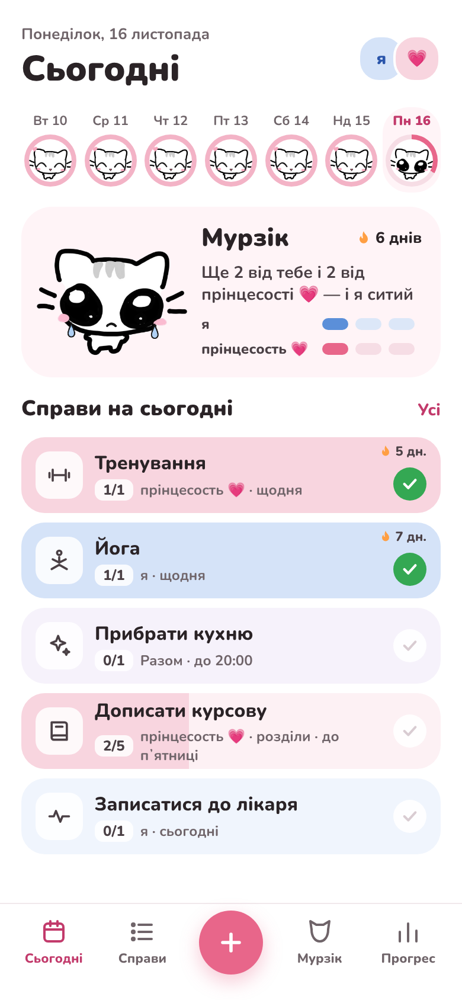

# Carranam: Design Guide

Interactive prototype with all screens: [open the design canvas](https://claude.ai/artifact/1HPMj4AmYbHgtNn2qLizX4) (Ukrainian UI)

## Screens

| Today | Tasks | New task |
|---|---|---|
|  |  |  |

| Murzik | Progress | Today, partner's view |
|---|---|---|
|  |  |  |

## Visual direction

Light and clean, in the spirit of Apple Reminders: a white background, soft rounded cards without borders, and a single typeface. The only hand-drawn element is the character, Murzik, which makes him the focal point of every screen.

**The card is the progress bar.** Each task card fills from left to right as it progresses: a task at 2 of 5 chapters is 40% filled, and a completed task is fully filled.

## Color

Colors are assigned **to people, not to "Me"**, so both partners see the same colors on their devices.

| Token | Value | Usage |
|---|---|---|
| `owner.me.fill` / `track` | `#F8D5DF` / `#FDF1F4` | First partner's cards and half of the bowl |
| `owner.partner.fill` / `track` | `#D5E3F8` / `#F0F5FD` | Second partner's cards and half of the bowl |
| `owner.together.fill` / `track` | `#E4DBF5` / `#F6F2FB` | Shared tasks |
| `brand.pink` | `#E8668A` | Add button, today's progress ring, bowl segments |
| `brand.pinkDark` | `#C23A6B` | Links and active navigation item (≥ 4.5:1 contrast) |
| `text.primary` / `secondary` / `muted` | `#2A2326` / `#4A4045` / `#6F6469` | Text |
| `cat.cardBackground` | `#FFF4F7` | Murzik card |
| `status.success` | `#34A853` | Completed task check |
| `status.streakFlame` | `#FF9F43` | Streak indicator |

All values are available in [`tokens.json`](tokens.json).

## Typography

**Nunito** (Google Fonts, Latin and Cyrillic), weights 600–900.

| Role | Size / weight |
|---|---|
| Screen title | 30 / 900 |
| Pet name | 21 / 900 |
| Section title | 17–18 / 900 |
| Task title | 16 / 800 |
| Body | 14 / 700 |
| Metadata, chips | 12 / 700–800 |
| Bottom navigation | 11 / 800 |

## Components

- **Task card.** 64 px tall, 20 px radius. A 40×40 icon tile on the left, followed by the title, a progress chip ("2/5") and metadata ("Me · daily"). On the right: the streak and a check circle with a 44 px touch target. The background fill shows progress and animates over 450 ms.
- **Pet card.** 26 px radius on `#FFF4F7`, containing the 136 px character, name, streak, a contextual hint and two rows of bowl segments, three per partner.
- **Week strip.** Seven 44 px circles showing the pet's face for each day. Today is shown as a progress ring (conic gradient).
- **Segmented control.** iOS style: gray track, selected segment in white with a soft shadow, 44 px tall.
- **Bottom navigation.** Today · Tasks · Add · Murzik · Progress. The Add button is a 54 px pink circle.

## Character

Murzik was hand-drawn by Tetiana Miskevych. Additional emotions were drawn in the same style.

| File | Mood | When |
|---|---|---|
| [`murzik-waiting.png`](murzik/murzik-waiting.png) | Waiting | 3–5 of 6 portions |
| [`murzik-hungry.png`](murzik/murzik-hungry.png) | Hungry | 0–2 portions |
| [`murzik-eating.png`](murzik/murzik-eating.png) | Eating | about 1.3 s after a task is completed |
| [`murzik-happy.png`](murzik/murzik-happy.png) | Happy | bowl is full |
| [`murzik-sleeping.png`](murzik/murzik-sleeping.png) | Sleeping | 23:00–07:00 |
| [`murzik-sad.png`](murzik/murzik-sad.png) | Sad | yesterday's bowl was not full |

The original sketch is in [`murzik/murzik-original-sketch.jpg`](murzik/murzik-original-sketch.jpg).

**Growth stages** ([`murzik/stages/`](murzik/stages)): kitten, teen with a bow (7 days), adult with a scarf (30 days), king with a crown (100 days).
The accessories are also available as separate SVG files in [`accessories/`](accessories). They share the character's coordinate system (`viewBox 0 0 676 596`), so they can be layered directly on top of the artwork.

## Icons

All icons are in [`icons/`](icons): 24×24 SVG, 2 px stroke, round caps and joins, color `#4A4045` (replace with `currentColor` in code).

- Navigation: `today`, `tasks`, `cat`, `progress`, `plus`
- Status: `check`, `flame`, `bowl`, `heart`, `crown`
- Task categories: `task-workout`, `task-yoga`, `task-cleaning`, `task-study`, `task-health`, `task-movie`, `task-call`, `task-car`, `task-reading`, `task-cooking`, `task-shopping`, `task-together`

## App icon

[`app-icon/`](app-icon) contains the happy Murzik on a pink `#F8D5DF` background:
- `icon-1024.png`: source and App Store size
- `icon-512.png`, `icon-192.png`: PWA manifest
- `maskable-512.png`: Android maskable icon with a larger safe area
- `apple-touch-icon-180.png`: iOS home screen
- `favicon-32.png`: browser tab

## Accessibility

- Text contrast of at least 4.5:1: muted `#6F6469` on white is 5.7:1 and `#C23A6B` is 5.1:1.
- On a fully filled pink card, `#6F6469` drops to 4.2:1, so metadata on filled cards should use `#4A4045` (over 7:1) in production.
- Touch targets are at least 44 px.
- Task ownership is shown with both color and text ("Me", the partner's nickname, "Together"), so color is never the only signal.
- Character animations are disabled when the system "reduce motion" setting is on.
